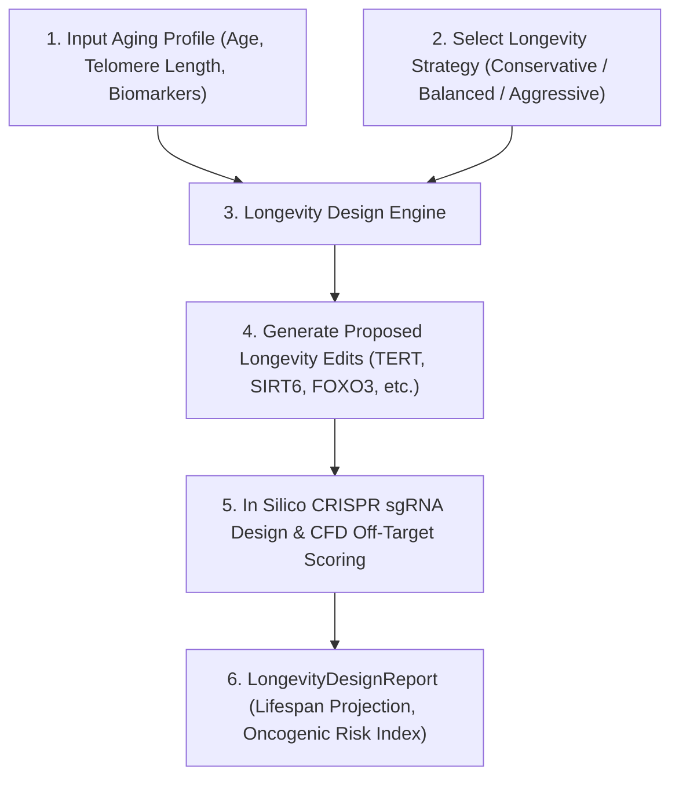

# scies-bio-th — v0.4 Design Document (Longevity & Synthetic Genome Design)

> A high-performance bio toolkit for Rust.  
> ส่วนขยายด้านชีววิทยาการชะลอวัย (Aging Biology), พลวัตของเทโลเมียร์ (Telomere Dynamics), และการออกแบบจีโนมสังเคราะห์ (Synthetic Genome Engineering).

---

## 1. เป้าหมายของโปรเจกต์ใน v0.4

ใน **v0.4**, `scies-bio-th` ก้าวล้ำไปสู่การเป็นเครื่องมือจำลองและออกแบบพันธุวิศวกรรมระดับสังเคราะห์ (**Synthetic Genome Design**) โดยมุ่งเน้นไปที่:
1. **Telomere Dynamics & Replicative Lifespan:** การสร้างแบบจำลองการหดสั้นของเทโลเมียร์ (End-replication problem + Oxidative stress) และขีดจำกัดเฮย์ฟลิก (Hayflick limit)
2. **Telomerase Mechanics & Regulation:** การจำลองการทำงานของ TERT/TERC Complex, Processivity และกลไก Safety-lock เพื่อควบคุมไม่ให้เกิดมะเร็ง
3. **Biological Epigenetic Clock:** การประเมินอายุชีวภาพ (Biological Age) และความเร่งของวัย (Aging Acceleration)
4. **Aging Pathways & Key Genes:** ฐานความรู้ยีนสำคัญที่ควบคุมกระบวนการแก่ชรา (SIRT1/6, FOXO3, TERT, POT1, p16, p53)
5. **Immortal Genome Design Pipeline:** Pipeline การเสนอชุดตัดต่อจีโนม (Proposed Longevity Edits) ด้วย CRISPR sgRNA, คำนวณความเสี่ยง Off-target (CFD Score), พร้อมกลยุทธ์ 3 ระดับ (Conservative, Balanced, Aggressive)

---

## 2. Module Tree (v0.4 Scope)

```text
scies_bio_th::
├── (เดิม) seq, io, align, codon, edit, genome, annotation, variant, motif, hmm, ivg, vaccine
├── (v0.3) transcriptomics, metagenomics, proteomics, popgen, phylo, genomics
└── (v0.4) aging
    ├── telomere    — Telomere shortening simulation, TTAGGG hexamer scanning, Shelterin capping
    ├── telomerase  — TERT/TERC catalytic model, processivity, and oncogenic risk assessment
    ├── clock       — Epigenetic biological age estimation and aging acceleration metrics
    ├── pathways    — Canonical longevity pathways (Telomere, DNA Repair, Nutrient Sensing, Senescence)
    └── design      — Immortal genome edit designer, LongevityStrategy, and LongevityDesignReport
```

---

## 3. Data Structures สำคัญ

- **`TelomereState`**: สถานะความยาวเทโลเมียร์ (bp), อัตราการหดตัวต่อรอบการแบ่งเซลล์, ความยาววิกฤต (Critical length), และดัชนี Shelterin capping
- **`TelomeraseActivity`**: ระดับการแสดงออก (0.0-1.0), Processivity (bp/binding), สถานะ Safety lock
- **`AgingProfile`**: อายุตามปฏิทิน, อายุทางชีวภาพ, สภาพเทโลเมียร์, ภาระเซลล์ชราภาพ (Senescence burden)
- **`ProposedLongevityEdit`**: ยีนเป้าหมาย, ประเภทการแก้ไข (Activate, Repress, Knock-in, Senolytic), พิกัดบนจีโนม, เหตุผลทางชีววิทยา, ค่าความเสี่ยง Off-target และ sgRNA candidate
- **`LongevityStrategy`**: 
  - `Conservative`: ปลอดภัยสูงสุด มุ่งเน้น DNA repair (SIRT6/FOXO3) และคงสภาพเทโลเมียร์
  - `Balanced`: (Default) ฟื้นฟูเทโลเมียร์แบบควบคุม + เร่งซ่อมแซม DNA + เพิ่มตัวตรวจจับมะเร็ง (Dual-layer p53)
  - `Aggressive`: กระตุ้น TERT ขั้นสูง + ล้างเซลล์ชราภาพอย่างเข้มข้น + ปรับปรุงเมแทบอลิซึม

---

## 4. Pipeline การทำงาน



---

## 5. Verification & Testing

- Unit tests จำลองการหดสั้นของเทโลเมียร์ตามรอบการแบ่งเซลล์
- Unit tests ประเมินอายุชีวภาพจาก Epigenetic markers
- Unit tests ออกแบบชุดแก้ไขจีโนมตามทั้ง 3 กลยุทธ์
- Example application: `examples/design_immortal_genome.rs`
